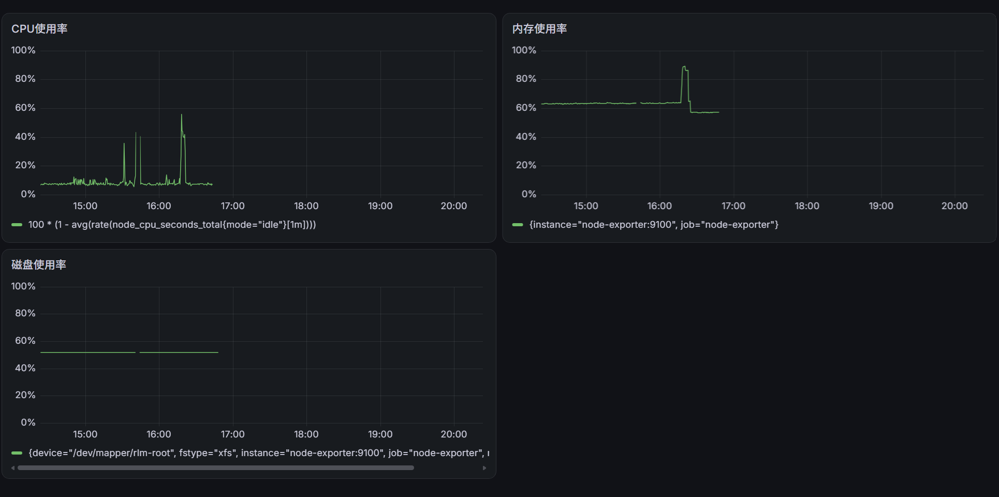

# Linux Server Monitoring & Alerting Lab

A Linux server monitoring and alerting system deployed
with Docker Compose.

## Tech Stack

- Prometheus
- Grafana
- Node Exporter
- Alertmanager
- Docker Compose
- Gmail SMTP

## Features

- Monitor Linux CPU, memory, and disk usage.
- Visualize system metrics using Grafana dashboards.
- Configure threshold-based alerting rules.
- Detect unavailable monitoring targets.
- Send firing and resolved alerts via Gmail SMTP.
- Manage sensitive credentials using local files excluded from Git.

## Architecture

```text
Rocky Linux Server
       |
       v
  Node Exporter
       |
       | System metrics (port 9100)
       v
   Prometheus ----------------> Grafana
       |                         |
       | Alert rules             | Dashboards
       v                         v
   Alertmanager              CPU / Memory / Disk
       |
       | SMTP (port 587)
       v
      Gmail
```

Prometheus collects Linux system metrics from Node Exporter.

Grafana visualizes the metrics, while Prometheus evaluates
alerting rules and forwards firing alerts to Alertmanager.

Alertmanager sends email notifications when alerts fire
and when they are resolved.

## Alert Rules

| Alert | Condition | Duration | Severity |
|---|---|---|---|
| HighCPUUsage | CPU > 80% | 1 minute | warning |
| HighMemoryUsage | Memory > 85% | 2 minutes | warning |
| HighDiskUsage | Root disk > 80% | 2 minutes | warning |
| InstanceDown | Node Exporter scrape fails | 1 minute | critical |

## Alert Verification

The alerting workflow was tested by:

1. Temporarily lowering the CPU alert threshold.
2. Confirming the alert entered Pending and Firing states.
3. Restoring the normal CPU threshold.
4. Stopping the Node Exporter container.
5. Confirming Prometheus reported `up = 0`.
6. Receiving a FIRING notification through Gmail.
7. Restarting Node Exporter and confirming `up = 1`.
8. Receiving a RESOLVED notification through Gmail.


## Deployment

### 1. Requirements

- Linux server with Docker and Docker Compose
- Internet access to pull Docker images
- Gmail account with 2-Step Verification enabled
- Gmail App Password for SMTP authentication

### 2. Configure Gmail

Copy the environment variable template:

```bash
cp .env.example .env
```

Edit `.env` and set your Gmail address:

```dotenv
GMAIL_ADDRESS=your_email@gmail.com
```

Create the password file:

```bash
mkdir -p secrets
chmod 700 secrets
```

Save your Gmail App Password to:

```text
secrets/gmail_app_password
```

Do not commit this file to Git.

### 3. Generate Alertmanager Configuration

Make sure `envsubst` is installed.

Run:

```bash
./scripts/setup.sh
```

This generates `alertmanager/alertmanager.yml`
from the public template.

### 4. Start Monitoring Services

```bash
sudo docker compose up -d
```

Check container status:

```bash
sudo docker compose ps
```

### 5. Access the Services

Prometheus: http://127.0.0.1:9090

Grafana: http://127.0.0.1:3000

Alertmanager: http://127.0.0.1:9093

All web interfaces are bound to the Linux host's
loopback address for security.

For remote access, use SSH port forwarding.

### 6. Configure Grafana

1. Open Grafana.
2. Add Prometheus as a data source.
3. Use `http://prometheus:9090` as the data source URL.
4. Create CPU, memory, and disk monitoring panels.

#### Monitoring Dashboard

The Grafana dashboard visualizes Linux CPU, memory, and disk usage metrics collected through Node Exporter and Prometheus.



### 7. Verify Alerting

Check Prometheus rules:

```bash
sudo docker compose exec prometheus \
  promtool check rules /etc/prometheus/alert_rules.yml
```

Check Alertmanager configuration:

```bash
sudo docker compose run --rm --no-deps \
  --entrypoint amtool alertmanager \
  check-config /etc/alertmanager/alertmanager.yml
```

### Security Notes

- Never commit Gmail App Passwords or `.env`.
- Store credentials in local files excluded by `.gitignore`.
- Restrict access to secret files.
- Do not expose Prometheus, Grafana, or Alertmanager
  directly to the public internet.
